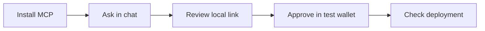

# Deploy to Fuji from One Chat Prompt

## Overview

Install the local **team1 Fuji Pilot** MCP bundle, then ask your assistant:

> Deploy a counter starting at 42 on Avalanche Fuji. Make my connected wallet the owner.

The assistant returns a local review link. Open it on the same computer, connect a **test wallet**, review the contract and fee ceiling, and approve or reject in your wallet. No AI editor, terminal, private key, seed phrase or AI API key is required for the Claude Desktop bundle workflow. This is a local pilot, pending team1 crypto/security and release review; it is not an official production deployment service.

The single starter stores a number. Only its owner can change it. It accepts no funds and has no token, upgrade or ownership-transfer functions. Mainnet is rejected by the tools and signing service; it needs a separate reviewed implementation.



## Learning objectives

- Deploy the bundled counter without handling a private key in chat.
- Review its source, owner, initial value and maximum test-AVAX cost before signing.
- Recover an interrupted request without deploying a duplicate contract.

## Prerequisites

- A desktop MCP client supporting Node-based `.mcpb` bundles, such as Claude Desktop, with a compatible Node runtime (20.11 or later). The downloadable bundle includes its JavaScript dependencies and compiler.
- A browser with an injected wallet such as Core or MetaMask, switched to **Avalanche Fuji, chain ID 43113**.
- A separate test wallet funded through the [existing Fuji faucet](https://go.team1.network/faucet). Keep wallets with real funds out of this pilot.
- Keep the MCP client and wallet browser on the **same computer**. The review page is loopback-only; it is not a mobile or remotely hosted signing service.

## Workshop

### Install and ask

1. Download `team1-fuji-pilot-0.1.0.mcpb` from the reviewed build supplied by the maintainer. Compare its supplied SHA-256 checksum if your installation workflow supports that.
2. Open the bundle in your MCP-compatible desktop client, review its local-server permissions, and install it. No wallet credential or API key should be requested.
3. Enable its tools in the chat and send the prompt above. The tool is called `prepare_deployment`; the assistant supplies the initial number from your request.
4. Open the returned signing link on this computer. Connect a Fuji test wallet, review the source and manifest, and click **Review and deploy on Fuji**. Your wallet requests the final approval.
5. Use **Check status**, or ask the assistant “Check that deployment,” until it reports confirmed. A prepared link or a wallet popup is not a confirmed deployment.

The prompt supports **only this counter starter**, with a nonnegative initial integer. Requests for NFTs, financial contracts, arbitrary generated Solidity or mainnet are outside the pilot. Do not describe this as a general prompt-to-any-dApp product.

### Understand the review

The page shows the signer/owner, initial number, expected contract address and maximum gas cost. **Download full manifest** includes source/build/ABI/bytecode fingerprints, compiler settings, chain ID, constructor arguments, nonce and fee limits. It is a public-data receipt; it contains no signing secret. The local ledger lives in `~/.team1-fuji-pilot` by default and is retained across MCP restarts.

Wallet signing stays outside the model: the MCP has no signing or transaction-broadcast tool. This separation depends on the user's wallet approval; review the wallet request as well as the page. Mainnet cannot be enabled with a prompt or environment flag in this pilot.

### Recover interruptions

- **You rejected the wallet popup:** the page records the rejection. Another request starts only when you click deploy again.
- **You approved but the response was interrupted:** do not deploy again. Reopen the same prompt/link, connect the same wallet, paste its transaction hash into **Recover transaction**, and check status.
- **The request is pending:** keep the reservation and check again. Never submit a second deployment to “speed it up.”
- **The transaction reverted or the ledger is locked:** keep the local records and ask the maintainer to investigate. Do not delete the ledger or force another attempt.

An attempt is reserved on disk **before** requesting the wallet transaction. A lost response remains blocked until reconciled. Repeated prompts and runtime restarts recover the recorded manifest for the same build, owner and initial value.

### Other MCP clients and ChatGPT

The same package is a standard **stdio MCP server**. Other clients can launch `node /absolute/path/to/the/unpacked-bundle/src/index.mjs`. This is a maintainer setup option, not a command the Claude Desktop bundle user needs to run.

ChatGPT does not install a local `.mcpb` directly. Its supported private connection route is **Secure MCP Tunnel**, which can forward to this stdio command. An operator must provision the tunnel/runtime credential and connect it to the intended ChatGPT account/workspace. The wallet review link must still open on the machine running this MCP. Do not expose the review server publicly. Tunnel setup and live ChatGPT use are not verified by the local package tests. See [OpenAI's current connection guide](https://developers.openai.com/api/docs/guides/custom-mcp-server) and [Secure MCP Tunnel](https://developers.openai.com/api/docs/guides/secure-mcp-tunnels).

### Maintainer setup and validation

Source: [`../assets/pilot`](../assets/pilot). Use Node 26.8.1 and pnpm 11.24.0 for the tested maintainer setup:

```sh
cd workshops/fuji-ai-editor/assets/pilot
pnpm install --frozen-lockfile --ignore-scripts
pnpm test
pnpm test:e2e
pnpm bundle
```

The E2E suite requires Foundry's `anvil` and Playwright Chromium (`pnpm exec playwright install chromium`). `ANVIL_BIN` and `CHROME_PATH` can select exact local executables. Tests launch only a loopback synthetic EVM. They do not broadcast to Fuji. The generated installer and checksum go in ignored `outputs/`; no runtime state, dependencies or compiled contract artifacts are committed.

To validate the installer itself, unpack it with `pnpm exec mcpb unpack outputs/team1-fuji-pilot-0.1.0.mcpb work/unpacked`, then run `PILOT_ENTRY="$PWD/work/unpacked/src/index.mjs" node --test test/mcp.test.mjs`. The bundle command already performs this installer smoke check. Use `PILOT_ROOT="$PWD/work/unpacked" pnpm test:e2e` to run the wallet flow against the unpacked runtime. Native Claude Desktop installation, an actual model prompt, hardware/extension-wallet UX and public Fuji verification remain separate acceptance checks.

**Architecture:** native Node HTTP/stdio, a bounded Solidity compiler subprocess, local JSON manifests/ledger and the browser's wallet provider. This local downloadable utility needs neither a hosted Next.js site, database nor login system. Kanit fonts and signing-page assets load locally, with no analytics, cookies or external frontend requests. Dependency versions and transitive overrides are locked with pnpm; AvaKit core supplies Fuji chain configuration and its RPC client, not signing capability. See [MAINTAINERS.md](../assets/pilot/MAINTAINERS.md) for approval and release status.

## Exercises

1. Reject a wallet request. Check that it does not deploy anything.
2. Change the requested number. Explain why its manifest represents a different contract intent.
3. Read the counter source and identify who can call `setNumber`.

## Next steps

Complete a supervised disposable-wallet Fuji run, explorer source verification and second-person installation rehearsal before distribution to a workshop audience. Mainnet requires contract review, production-owner/fee/signing policy, team1 Tech approval and a separate release; it is deliberately not a switch in this pilot.

## Resources

- [AvaKit core](https://avakit.dev/docs/core)
- [MCP bundle format](https://github.com/modelcontextprotocol/mcpb)
- [Fuji network details](https://build.avax.network/docs/primary-network)
- [Fuji faucet](https://go.team1.network/faucet)
- [Current team1 development guidelines](https://docs.google.com/document/d/1zAEml61gOIm38y297gRY9P5D8LF8-LSJkBlPbZSLxmM/edit?tab=t.0)
